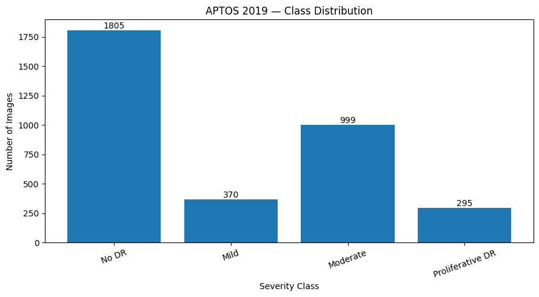
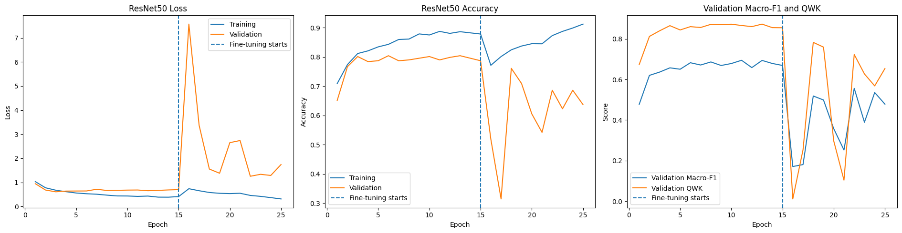
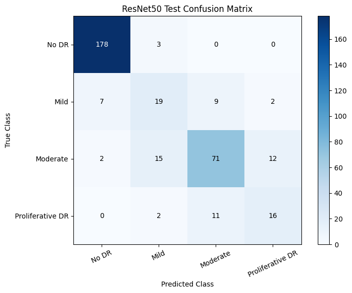

# Automated Diabetic Retinopathy Severity Classification

**ResNet50 · Transfer Learning · Medical Image Classification · Grad-CAM · TensorFlow**

A **CSE427 (Machine Learning)** project developed at **BRAC University** by **Pretom Areefin Pranto** and **Md. Farhad Hossain Shishir**.

This repository contains our **original Google Colab notebook**, saved experimental outputs, and project documentation for automated diabetic retinopathy (DR) severity classification from retinal fundus images. The implementation uses an ImageNet-pretrained ResNet50, two-stage transfer learning, class-weighted training, test-time augmentation, and model interpretation with Grad-CAM.

> **Educational/research project — not a medical device.** The model has not been clinically validated and must not be used for patient diagnosis or treatment decisions.

## Project overview

Diabetic retinopathy is a diabetes-related retinal condition that can affect vision. This project investigates whether a convolutional neural network can categorize its severity using retinal fundus images, while addressing class imbalance and showing which image regions influence predictions.

### Highlights

- **Dataset:** 3,469 processed fundus images from the **APTOS 2019 Blindness Detection** dataset.
- **Task:** Four-class severity classification — **No DR**, **Mild**, **Moderate**, and **Proliferative DR**.
- **Split:** Stratified image-level **80% training / 10% validation / 10% testing** (2,775 / 347 / 347 images; seed 42).
- **Model:** ImageNet-pretrained **ResNet50** with a custom classification head; frozen-backbone training followed by partial fine-tuning.
- **Training:** Augmentation and **class-weighted sparse categorical cross-entropy**, with checkpoint selection using validation quadratic weighted kappa (QWK).
- **Evaluation:** Accuracy, macro-F1, balanced accuracy, QWK, class-wise metrics, and horizontal-flip test-time augmentation (TTA).
- **Interpretability:** **Grad-CAM** visualizations for examining image regions influencing model output.

**Important scope note:** APTOS 2019 originally contains **five** labels. Our notebook removes the original *Severe DR* label (class 3) and remaps *Proliferative DR* (class 4) to class 3. The reported performance applies to **four classes**, not all five APTOS categories.

## Reported held-out test results

These numbers are taken from the **saved outputs in the submitted Colab notebook**. They have **not been independently rerun** in a new environment.

| Metric | Result |
| --- | ---: |
| Accuracy (without TTA) | 78.67% |
| **Accuracy (with TTA)** | **81.84%** |
| Balanced accuracy | 68.97% |
| **Macro-F1** | **68.83%** |
| Weighted F1 | 81.75% |
| **Quadratic weighted kappa** | **0.8975** |
| Ordinal mean absolute error | 0.1988 |
| Within-one-grade accuracy | 98.27% |
| Held-out test images | 347 |

The class imbalance remains important: No DR has stronger per-class performance than the minority Mild DR and Proliferative DR categories. A high overall accuracy should therefore not be read as equivalent performance for every severity class.

## Experimental visualizations

**Class distribution**

**Training and validation metrics**

**Held-out test confusion matrix**

The figures above were extracted from the notebook's saved outputs; other visualizations, including Grad-CAM examples, are available in the original notebook.

## Technologies

`Python` · `TensorFlow / Keras` · `ResNet50` · `scikit-learn` · `NumPy` · `Pandas` · `OpenCV` · `Pillow` · `Matplotlib` · `Google Colab`

## Project presentation
[📄 View Project Presentation (PDF)](CSE427_Automated%20Diabetic%20Retinopathy%20Severity%20Classification.pdf)

## Limitations

- The experimental pipeline evaluates **four classes**, excluding original Severe DR cases.
- Performance is uneven across classes because of imbalanced class frequencies.
- The supplied materials do not establish a patient-independent split or validation on an external clinical dataset.
- Grad-CAM visualizations are interpretability aids, **not** proof of clinically meaningful lesion localization.
- Original Colab code includes a project-specific Google Drive path; update it locally before executing in another environment.

## Contributors

- **Pretom Areefin Pranto** — BRAC University · [GitHub](https://github.com/pretom26)
- **Md. Farhad Hossain Shishir** — BRAC University

This is a **joint academic project**.
